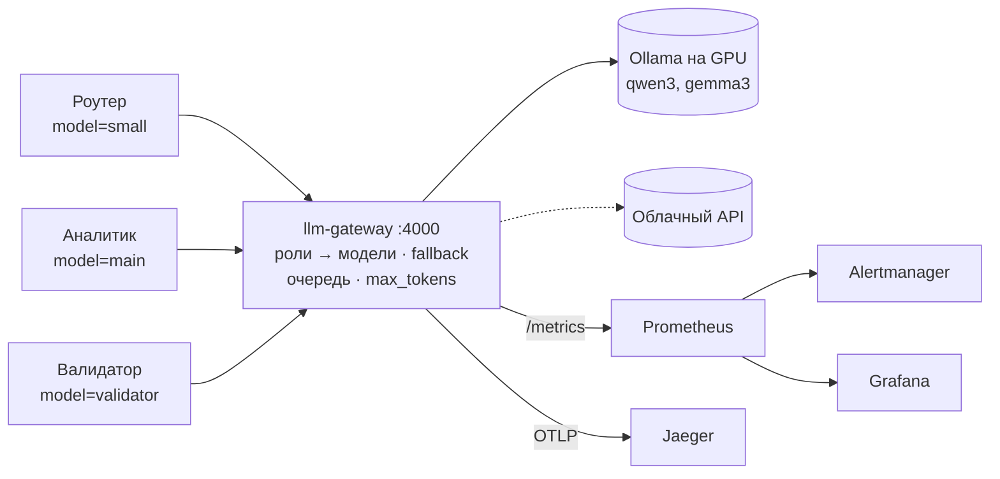

# LLM Gateway

[](https://github.com/avequa/llm-gateway/actions/workflows/ci.yml)


OpenAI-совместимый шлюз к языковым моделям на Go. Агенты обращаются к одной точке и просят **роль** (`small`, `main`, `validator`), а шлюз сам выбирает модель, переключается на запасную при сбое, держит очередь к видеокарте, ограничивает генерацию и пишет метрики и трейсы.

Часть проекта **Incident Copilot** — мультиагентной системы разбора инцидентов: агенты на LangGraph, инструменты на Go ([incident-radar](https://github.com/avequa/incident-radar)), модели через этот шлюз.



## Возможности

- **Роли вместо моделей.** Агент пишет `model: "main"`, шлюз по конфигу подставляет реальную модель. Чтобы сменить модель, достаточно правки одной строки YAML, код агентов не меняется.
- **Fallback.** У роли цепочка моделей. Если модель не найдена (404), перегружена (429), упала (5xx) или не ответила вовремя, шлюз пробует следующую. При ошибке запроса (400) не переключается. Работает и для стриминга.
- **Очередь к апстриму.** `max_concurrent` слотов на сервер моделей: для Ollama на одной видеокарте это один запрос за раз, остальные ждут. Если очередь не сдвинулась за `queue_timeout`, клиент получает 429 с `Retry-After`.
- **Параметры ролей.** `params` — значения по умолчанию (например, `reasoning_effort: none`, `temperature`), `max_tokens` — потолок длины ответа.
- **Прозрачный прокси.** Тело запроса не переписывается целиком, меняется только `model`: `tools`, `response_format` и любые новые поля API проходят как есть. Стриминг SSE передаётся по кусочкам сразу. Если агент отключился, генерация в модели отменяется.
- **Наблюдаемость.** Метрики Prometheus по ролям и моделям: запросы, латентность, время до первого токена, токены, fallback, очередь. Трейсы OpenTelemetry с атрибутами `gen_ai.*`, `traceId` в каждой строке лога.
- **Готовый стек** в docker-compose: Ollama на GPU, Prometheus с правилами алертов, Alertmanager, Grafana с дашбордом, Jaeger.
- **Аккуратная эксплуатация:** graceful shutdown, ошибки в формате OpenAI, строгая проверка конфига (все ошибки сразу), ключи API только из окружения, образ distroless от непривилегированного пользователя, healthcheck без shell.

## Быстрый старт

### Локально

Нужны Go 1.26+ и [Ollama](https://ollama.com) с одной маленькой моделью:

```bash
ollama pull qwen3:4b
cp config.example.yaml config.yaml
make run                                    # http://127.0.0.1:4000
```

```bash
curl -s localhost:4000/v1/chat/completions -H 'Content-Type: application/json' \
  -d '{"model":"small","messages":[{"role":"user","content":"Скажи одно слово: привет"}]}'
```

В заголовках ответа `X-Gateway-Target` показывает, какая модель ответила, а `X-Gateway-Attempts` — с какой попытки.

### Всё в Docker: Ollama на GPU и стек наблюдаемости

Нужны Docker с поддержкой NVIDIA GPU (Docker Desktop на Windows с WSL 2 или Docker Engine с NVIDIA Container Toolkit) и одна маленькая модель.

```bash
cp .env.example .env                # путь к уже скачанным моделям Ollama, если они есть
make up                             # Ollama, шлюз, Prometheus, Alertmanager, Grafana, Jaeger
make pull MODEL=qwen3:4b            # если моделей ещё нет
make models                         # PROCESSOR должен быть 100% GPU после первого запроса
make smoke                          # пять коротких запросов для проверки
```

| Сервис | Адрес |
|---|---|
| Шлюз | http://127.0.0.1:4000 |
| Ollama | http://127.0.0.1:11434 |
| Grafana (дашборд «LLM Gateway», вход admin / admin) | http://127.0.0.1:3000 |
| Prometheus | http://127.0.0.1:9090 |
| Alertmanager | http://127.0.0.1:9093 |
| Jaeger | http://127.0.0.1:16686 |

Шлюз находит Ollama по имени сервиса, поэтому стек одинаково работает на Linux и в Docker Desktop с WSL. Если на машине уже стоит Ollama как системная служба, её стоит выключить (`sudo systemctl disable --now ollama`): иначе две Ollama делят одну видеокарту. Уже скачанные модели подключаются в контейнер из папки, указанной в `.env`, и заново не скачиваются.

Ollama ограничена одним запросом на модель и двумя моделями в видеопамяти, через 5 минут простоя модель выгружается. Все порты открыты только на `127.0.0.1`. У сервисов наблюдаемости свои лимиты памяти, вместе они занимают около 0.5 ГБ RAM. `make down` останавливает стек, `make ps` показывает потребление памяти.

### Из Python

```python
from openai import OpenAI
client = OpenAI(base_url="http://127.0.0.1:4000/v1", api_key="unused")
client.chat.completions.create(model="main", messages=[{"role": "user", "content": "Когда начался инцидент?"}])

from langchain_openai import ChatOpenAI
llm = ChatOpenAI(base_url="http://127.0.0.1:4000/v1", api_key="unused", model="main")
```

## Конфигурация

```yaml
server:
  addr: 127.0.0.1:4000
  shutdown_timeout: 15s

upstreams:
  ollama:
    base_url: http://localhost:11434/v1
    timeout: 120s          # ожидание начала ответа, а не всей генерации
    max_concurrent: 1      # одна видеокарта — один запрос
    queue_timeout: 180s    # сколько ждать слота, потом 429
  # openrouter:
  #   base_url: https://openrouter.ai/api/v1
  #   api_key_env: OPENROUTER_API_KEY

models:
  main:
    params: {reasoning_effort: none}
    max_tokens: 2048
    targets:
      - {upstream: ollama, model: qwen3:4b}
      - {upstream: ollama, model: qwen3:1.7b}
  validator:               # другое семейство моделей, чем main
    params: {temperature: 0}
    targets:
      - {upstream: ollama, model: gemma3:4b}
```

Полный пример с комментариями — [config.example.yaml](config.example.yaml), конфиг для Docker — [deploy/gateway.yaml](deploy/gateway.yaml).

| Поле | По умолчанию | Смысл |
|---|---|---|
| `server.addr` | `127.0.0.1:4000` | адрес шлюза |
| `server.shutdown_timeout` | `15s` | сколько ждать активные запросы при остановке |
| `upstreams.*.base_url` | — | OpenAI-совместимый адрес (`.../v1`) |
| `upstreams.*.api_key_env` | — | имя переменной окружения с ключом |
| `upstreams.*.timeout` | `120s` | ожидание начала ответа модели |
| `upstreams.*.max_concurrent` | `4` | одновременных запросов к апстриму |
| `upstreams.*.queue_timeout` | `60s` | ожидание свободного слота |
| `models.*.targets` | — | цепочка `{upstream, model}` для fallback |
| `models.*.params` | — | значения по умолчанию для полей запроса |
| `models.*.max_tokens` | без потолка | потолок длины ответа |

Конфиг разбирается строго: опечатка в имени поля — ошибка. Все ошибки выводятся сразу, с путём к полю.

Переменные окружения: `OTEL_EXPORTER_OTLP_ENDPOINT` включает трейсы (например, `http://jaeger:4318`), `OTEL_SERVICE_NAME` задаёт имя сервиса (по умолчанию `llm-gateway`). Флаги: `--config`, `--log-format text|json`, `--log-level`.

## HTTP API

| Метод и путь | Ответ |
|---|---|
| `POST /v1/chat/completions` | ответ модели (JSON или поток SSE) в формате OpenAI |
| `GET /v1/models` | список ролей в формате OpenAI |
| `GET /metrics` | метрики Prometheus |
| `GET /healthz` | `ok` |

| Ситуация | Код |
|---|---|
| неизвестная роль | 404 `model_not_found` со списком ролей |
| неверное тело / `max_tokens` | 400, тело больше 16 MiB — 413 |
| все модели роли не ответили | ошибка последней модели, 502 `upstream_unavailable` или 504 `upstream_timeout` |
| очередь не сдвинулась | 429 `upstream_busy`, `Retry-After: 5` |

## Наблюдаемость

| Метрика | Тип | Метки |
|---|---|---|
| `llm_gateway_requests_total` | counter | `model`, `target`, `status` |
| `llm_gateway_request_duration_seconds` | histogram | `model`, `stream` |
| `llm_gateway_time_to_first_token_seconds` | histogram | `model`, `target` |
| `llm_gateway_tokens_total` | counter | `model`, `target`, `type` (prompt / completion) |
| `llm_gateway_target_failures_total` | counter | `model`, `target`, `reason` (404, busy, timeout, unavailable…) |
| `llm_gateway_upstream_inflight_requests` | gauge | `upstream` |
| `llm_gateway_upstream_queue_waiting` | gauge | `upstream` |
| `llm_gateway_upstream_queue_wait_seconds` | histogram | `upstream` |

Токены берутся из `usage` ответа модели. Для стриминга шлюз сам добавляет `stream_options.include_usage`, если агент его не указал.

**Алерты** ([deploy/prometheus/alerts.yml](deploy/prometheus/alerts.yml)): шлюз недоступен; больше 20% ошибок; p95 ответа больше 60 с; p95 до первого токена больше 15 с; частый fallback на цели; очередь не рассасывается. Алерты видны в Alertmanager и на дашборде. Отправка в Telegram включается в [deploy/alertmanager/alertmanager.yml](deploy/alertmanager/alertmanager.yml).

**Дашборд Grafana** подключается автоматически: текущее состояние, трафик по ролям и кодам, какая модель реально отвечает, fallback, p50/p95 латентности и времени до первого токена, токены, очередь, память шлюза.

**Трейсы:** `POST /v1/chat/completions` → `attempt <upstream>/<model>` на каждую попытку → `upstream <name>` (HTTP-запрос к модели). Шлюз принимает `traceparent` от агентов и передаёт его модели, поэтому трейс агента, шлюза и модели получается сквозным.

## Разработка

```bash
make check       # go mod tidy -diff, gofumpt, goimports, golangci-lint (gosec, errorlint, revive, modernize…)
make test        # тесты с покрытием
make test-race   # тесты с race detector
make docker      # образ llm-gateway:dev (distroless, ~30 MB)
```

Тесты используют фейковый OpenAI-совместимый апстрим на `httptest`: проверяются подмена модели, параметры ролей, fallback, очередь, стриминг без буферизации, отмена при отключении клиента, метрики, токены из потока, вложенность span и передача `traceparent`. CI на каждый push: линтеры, тесты с `-race`, проверка конфигов Prometheus, Alertmanager и compose, сборка образа.

```text
cmd/llm-gateway/      точка входа, флаги, slog, сигналы, подкоманда healthcheck
internal/config/      загрузка и проверка YAML
internal/server/      маршруты, chat completions, fallback, разбор usage, graceful shutdown
internal/upstream/    HTTP-клиент к апстриму и очередь слотов
internal/metrics/     метрики Prometheus
internal/telemetry/   трейсы OpenTelemetry (OTLP)
deploy/               Prometheus, алерты, Alertmanager, Grafana, конфиг шлюза для Docker
compose.yaml          стек целиком, .env.example - его настройки
```
